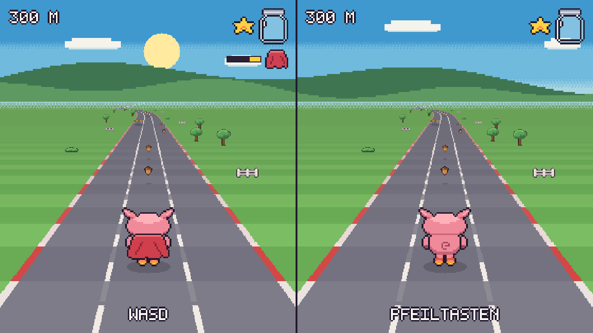

# Edgar!

Edgar is a little pig on roller skates, and roller skates have no brakes. Three lanes, a road
running to the horizon, hurdles to jump, gates to duck under, hay wagons to ride over, streams to
cross by the bridge, and chickens, ducks and cows wandering across — and Bello, the farm dog, who
catches up if Edgar stumbles twice. Acorns fill a jar, and a full jar gives a helmet, a cape, a
magnet or a turbo. The further Edgar gets, the faster he goes, from afternoon through sunset and
night to the next morning.



## Play it here

https://heidkaemper.github.io/edgar/

> [!NOTE]
> Menus and messages are in German.

## Built with

TypeScript on a plain HTML5 canvas, no game engine and no runtime dependencies — all graphics are
pixel data in the source and the sound is synthesised in the browser.
[Vite](https://vite.dev) for dev server and build,
[ESLint](https://eslint.org) with `typescript-eslint` for linting.

To run it locally:

```bash
npm install
npm run dev
```

## On the Switch

It also runs on a homebrew-enabled Nintendo Switch. That build is a project of its own
in [`switch/`](switch/) and shares this source tree.
